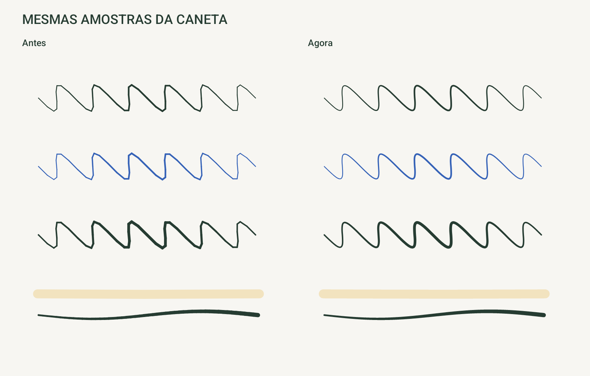

# Folha para Android

Cadernos e anotações em PDF para tablets Android, com foco na Samsung S Pen.

## Baixar ou atualizar

**[Baixar APK mais recente](https://github.com/GusDesign0/folha-android/releases/latest/download/Folha.apk)** · **[Baixar em ZIP](https://github.com/GusDesign0/folha-android/releases/latest/download/Folha.zip)** · [Histórico de versões](https://github.com/GusDesign0/folha-android/releases)

No tablet, abra o APK no **Meus Arquivos** e escolha **Instalar** ou **Atualizar**. Para atualizar, instale por cima: não desinstale o aplicativo anterior, pois os cadernos ficam nos dados locais do app.

Requer Android 10 ou superior. Compilado para Android 16. APK independente, fora da Play Store.

## Recursos da versão 0.2.0

- Cadernos com papel pautado, quadriculado, pontilhado ou em branco, páginas e pastas.
- Importação e leitura de PDF com anotações.
- Caneta com pressão suavizada, marca-texto, borracha de traços e desfazer/refazer.
- Dedos para navegar e ampliar; escrita exclusiva da caneta por padrão.
- Salvamento automático local e exportação de PDF.
- Escrita e marca-texto exportados como caminhos, preservando as bordas no zoom.



## Limites atuais

O conteúdo original de PDFs importados é rasterizado na exportação da versão 0.2.0. As anotações feitas no Folha permanecem em caminhos. Ainda não há sincronização, backup editável, laço ou reconhecimento de escrita.

Os testes usam emulador Android 16 com eventos sintéticos de caneta e palma. A sensação, pressão e latência reais devem ser verificadas na S Pen física.

## Código e compilação

O código usa Java e APIs nativas do Android. Não depende do Android Studio ou de Gradle.

```powershell
.\setup.ps1
```

O script baixa ferramentas oficiais, verifica os checksums e gera o APK. Para recompilar com as ferramentas disponíveis:

```powershell
.\build.ps1
```

A chave de assinatura fica **somente no ambiente local**, fora deste repositório. As versões publicadas usam a mesma chave para permitir atualizações. Uma compilação com outra chave não atualiza diretamente o APK distribuído.

[Detalhes técnicos, testes e limitações](docs/DESENVOLVIMENTO.md).

Projeto independente, sem afiliação com Goodnotes ou Samsung.
