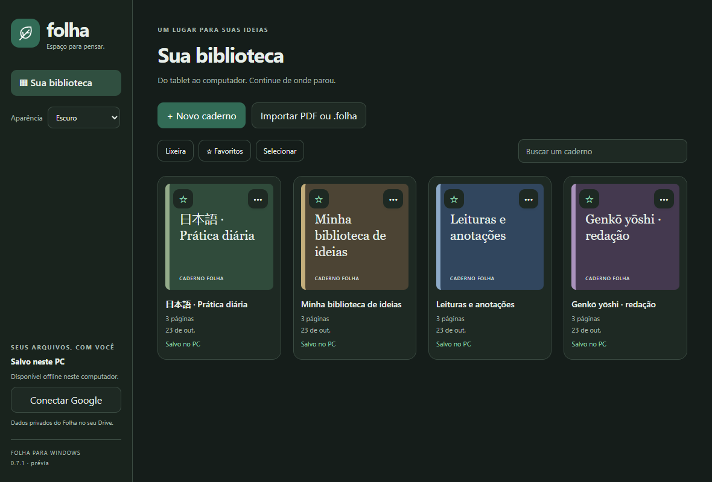
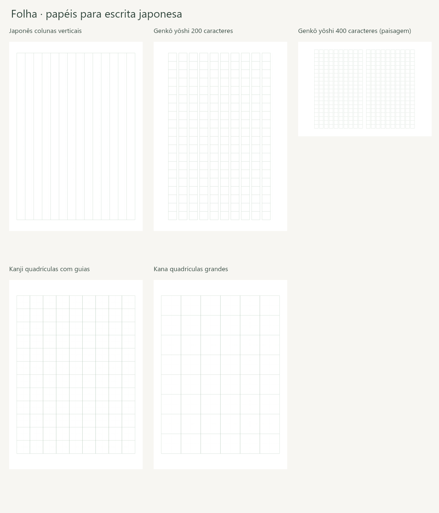

# Folha - Android e Windows

Cadernos, S Pen e estudo de PDFs, com sincronização privada no Google Drive.

[Baixar Android](https://github.com/GusDesign0/folha-android/releases/latest/download/Folha.apk) | [Baixar Windows](https://github.com/GusDesign0/folha-android/releases/latest/download/Folha-Windows.zip) | [ZIP Android](https://github.com/GusDesign0/folha-android/releases/latest/download/Folha.zip)

## Versão 0.7.1

- Aparência clara, escura ou seguindo o sistema, salva por aparelho. Troca em tempo real sem recriar a página, alterar papel/PDF/tinta ou limpar desfazer/refazer.
- Biblioteca com ações principais separadas dos filtros, seleção em lote explícita e menu por arquivo. Ferramentas secundárias agrupadas; cabeçalho e rodapé do PC adaptados a janelas menores.
- Ajuste à largura no PC acompanha redimensionamentos e o modo foco; zoom manual é mantido.

### Recursos de estudo preservados

- Cinco papéis japoneses: colunas verticais, genko yoshi 200/400 caracteres, kanji com guias e kana. Prévia, modelo paisagem de 400 caracteres e PDF com o mesmo papel.
- Busca no texto de PDFs e nas notas digitadas; sumário quando disponível e modo de leitura contínua. Toque em uma página para voltar a editar. A busca não realiza OCR.
- Até seis canetas favoritas no tablet, com tipo, cor, espessura, pressão e suavização; modo foco nos dois aplicativos.
- Biblioteca com estrelas, recentes, cinco cores de capa, seleção em lote para pasta/lixeira e estado de sincronização por arquivo.
- Windows com leitura e texto: mover, redimensionar e alinhar caixas, além de desfazer/refazer. A escrita e as imagens do tablet são exibidas e preservadas.
- Até 12 versões locais por caderno; recuperação como outra cópia, sem substituir a atual. Histórico local não sincronizado e fora do backup .folha.

Tablet: ícone de sol no alto. PC: seletor Aparência. A opção de sistema acompanha mudanças do dispositivo enquanto o app está aberto. O papel continua com suas cores originais; não há inversão visual dos PDFs. As ferramentas extras do tablet estão em + Ferramentas; organizar/excluir no PC usa o botão de três pontos do arquivo.

[Papéis japoneses e referência de escrita](docs/PAPEIS-JAPONESES.md) | [Validação](docs/VALIDACAO.md) | [Build](docs/BUILD.md) | [Sincronização](docs/SINCRONIZACAO.md) | [Formato](docs/FORMATO.md)

## Instalação e atualização

Tablet: Android 10 ou posterior (alvo API 36), Samsung/S Pen recomendado; abra o APK e escolha Atualizar sem desinstalar. É uma versão independente, fora da Play Store. Windows: 10/11 x64 com .NET Framework 4.8 e Edge WebView2; feche prévias anteriores e extraia o ZIP inteiro. Sua biblioteca fica no perfil do Windows, fora da pasta do programa. Atualize ambos para os novos papéis e campos.

Conecte a mesma conta Google nos dois aparelhos. Feche o caderno e use Sincronizar agora antes de trocar de dispositivo. A escrita funciona offline; alterações simultâneas são preservadas em cópias de conflito. Login em prévia com a conta de teste cadastrada; o tablet requer Google Play Services. Conferência de conta/sincronização em dois aparelhos físicos ainda depende do usuário.

## Limites práticos

A leitura contínua é um modo de consulta; a escrita ocorre no editor por página. Busca retorna até 200 páginas e pode ser cancelada. OCR e reconhecimento automático de escrita não estão incluídos. Os papéis japoneses orientam a escrita manual; não compõem automaticamente texto digitado na vertical. O Windows exporta texto com Helvetica/WinAnsi; japonês digitado e outros caracteres fora dessa cobertura ainda precisam de suporte de fontes. A escrita à mão segue em caminhos PDF.

Papéis reutilizam geometria, a leitura renderiza sob demanda (16 MiB no Android; até cinco páginas no Windows), e busca/histórico rodam fora da entrada da caneta. Resultados de CPU em emulador não medem a latência física da S Pen.

O Android tem Atualizar app via GitHub, com validação de tamanho, SHA-256, versão e assinatura. Windows é atualizado pelo ZIP. Guarde backups .folha independentes; a lixeira conserva os arquivos e ainda não oferece exclusão definitiva.

## Testes

Gradle e scripts Android executam cenários de escrita, gestos e geometria dos papéis. O teste no emulador inclui atualização sobre cadernos antigos, PDF, rotação, versões e ciclo de leitura. C# cobre texto imutável em relação à tinta/imagens, conflitos, lixeira, versões e interoperabilidade Java/C#. Os adaptadores JavaScript podem ser executados com `npm install` e `npm test` após baixar dependências do desktop pelo script próprio. São dependências só de desenvolvimento.

Chaves de assinatura e autorizações pessoais não acompanham o código. Esta versão não é um aplicativo para iPadOS, macOS ou Linux.
