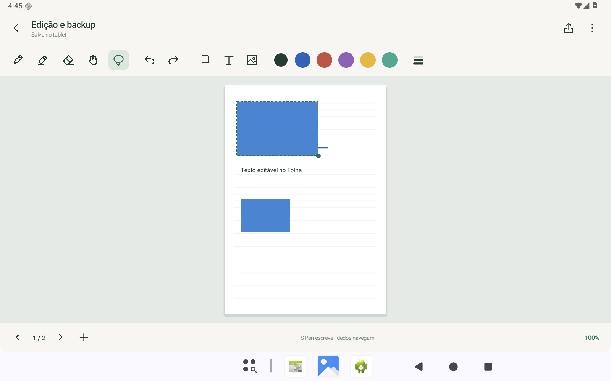

# Folha para Android

Cadernos e anotações em PDF, com foco em tablets Samsung e S Pen.

**[Baixar APK mais recente](https://github.com/GusDesign0/folha-android/releases/latest/download/Folha.apk)** · **[Baixar ZIP](https://github.com/GusDesign0/folha-android/releases/latest/download/Folha.zip)** · [Versões anteriores](https://github.com/GusDesign0/folha-android/releases)

## Instalar e atualizar

No tablet, abra o APK pelo **Meus Arquivos** e escolha **Instalar** ou **Atualizar**. Instale por cima da versão anterior, sem desinstalar, para manter os cadernos.

A partir da 0.4.0, use **Atualizar app** para as próximas versões. Na primeira vez, o Android poderá pedir que você permita instalar apps pelo Folha. Volte ao app após permitir e confirme a instalação. A confirmação do Android continua necessária. Não há serviço ou consulta periódica: só verifica quando você tocar no botão.

Requer Android 10 ou superior. Alvo Android 16. APK independente, fora da Play Store.

## Versão 0.4.0

- **Escrita:** esferográfica, tinteiro, pincel e marca-texto, com cores, espessura, pressão e suavização ajustáveis.
- **Borracha:** apaga uma parte ou o traço inteiro.
- **Laço:** seleciona, move, redimensiona, copia, duplica, apaga e recolore. Permite colar em outra página do mesmo caderno.
- **Texto e imagens:** inserção nas páginas, com seleção, movimento e redimensionamento. Texto pode ser editado depois.
- **Cadernos:** páginas pautadas, quadriculadas, pontilhadas ou em branco, nomes e pastas.
- **PDF:** leitura, anotação e exportação que preserva o documento original, incluindo texto selecionável e links. Escrita e marca-texto são acrescentados como caminhos.
- **Backup editável .folha:** guarda pontos, textos, imagens e PDF original; restaura em outro aparelho e cria uma cópia quando o caderno já existe.
- **Atualizações:** botão **Atualizar app** na biblioteca ou nas opções do caderno. Consulta o GitHub e baixa o APK com progresso e cancelamento. Confere tamanho, SHA-256, versão, pacote e assinatura antes de abrir o instalador do Android.
- **Offline:** criação, escrita, organização e leitura funcionam sem rede.

Para escolher o tipo da caneta, segure seu ícone. Segure a borracha para trocar o modo. Com o laço, contorne os objetos e arraste a seleção ou a bolinha do canto. O ícone de folhas sobrepostas abre copiar/colar e edição de texto.



## Desempenho e validação

A caneta trabalha com a página aberta, reutiliza a geometria pronta e acrescenta traços ao cache sem redesenhar toda a página. Leitura de arquivo, JSON, PDF e backup usam filas de segundo plano. A biblioteca carrega metadados leves e as imagens possuem limites de resolução e memória.

Foram executados 21 cenários de lógica e testes de integração no Android 16, incluindo atualização, pressão, palma, laço, borracha parcial, texto/imagem, backup e PDFs girados/recortados. Em uma cena sintética com 250 traços, a CPU de desenho teve p50 de 1,882 ms e p95 de 2,491 ms no emulador. Isso não mede latência física da S Pen nem garante taxa de quadros no aparelho.

[Validação e limites](docs/VALIDACAO.md).

## Tablet e Windows

O aplicativo Windows, a conta e a sincronização estão planejados; ainda não estão implementados. O backup usa um formato portátil com IDs, revisões, coordenadas de página e imagens relativas, para ser reutilizado nos dois sistemas. A escrita deve continuar offline, e a futura sincronização deverá tratar conflitos sem sobrescrever o trabalho.

[Formato e plano de sincronização](docs/FORMATO.md).

## Compilar

```powershell
.\setup.ps1
```

O script obtém JDK e ferramentas oficiais do Android com checksums. Dependências de PDF também são baixadas de fontes oficiais e verificadas. Para recompilar:

```powershell
.\build.ps1
```

Resultado: `Folha.apk`. A chave de assinatura fica apenas no ambiente local, fora do repositório. As versões distribuídas usam a mesma chave. Uma compilação com outra chave não atualiza diretamente o APK publicado.

Para executar os testes em um emulador com ADB, instale o APK e execute `test-device.ps1`. A fixture de PDF é enviada pelo script.

[Desenvolvimento e dependências](docs/DESENVOLVIMENTO.md). Projeto independente, sem afiliação com Goodnotes ou Samsung.
